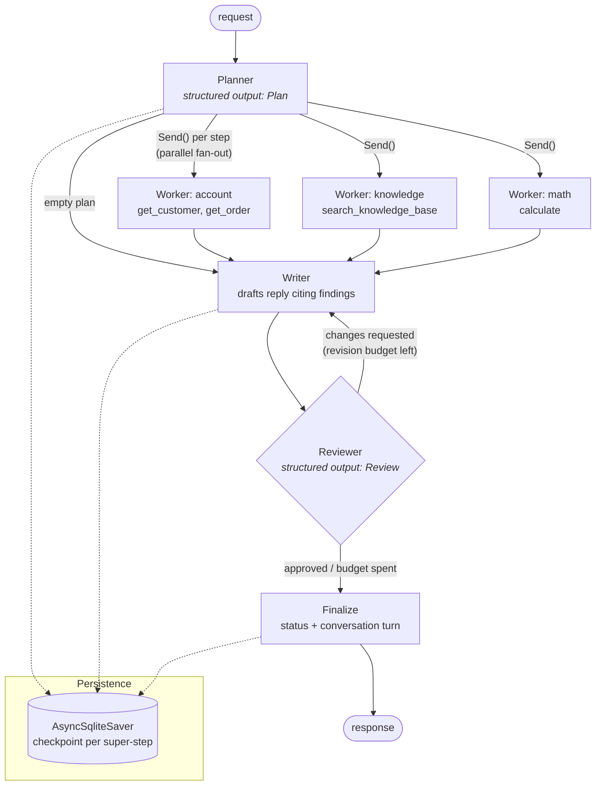
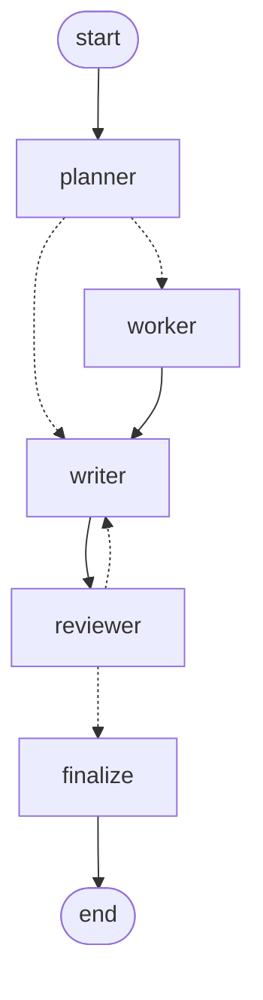

# langgraph-support-agents

[](https://github.com/hakim86dev-eng/langgraph-support-agents/actions/workflows/ci.yml)


A **multi-agent customer-support backend** built with **LangGraph** and served with **FastAPI**.
A planner splits each request into steps. Tool-using worker agents run those steps **in
parallel**. A writer drafts the reply and a **reviewer** either approves it or sends it back with
feedback. Every conversation is a **checkpointed thread** in SQLite, so it survives restarts and
keeps a full step-by-step history.

It ships with an offline `demo` model and a tool-calling **fake chat model**, so the service, the
41 tests and the CI all run without API keys. Switch to OpenAI, Anthropic or Ollama with one
environment variable.

## Architecture



You can reproduce the compiled graph with `build_graph(...).get_graph().draw_mermaid()`.



## Features

- **Planner → workers → reviewer** built from LangGraph primitives: `StateGraph`, conditional edges, and the `Send` API for map-style parallel fan-out.
- **Tool-using workers**: each worker runs its own bounded ReAct loop (`bind_tools` → tool calls → `ToolMessage` → summary) with a per-worker tool allow-list. Unknown tools and tool exceptions go back to the model as errors and don't crash the run, and an iteration budget prevents runaway loops.
- **Structured outputs** (`with_structured_output`) for the plan and the review, validated by Pydantic. Workers are a `Literal` type, so the planner can't invent one.
- **Self-correction with a budget**: the reviewer can request changes up to `AGENT_MAX_REVISIONS` times. After that, the run ends as `needs_human_review` instead of looping.
- **Graceful degradation**: if the planner returns malformed output, the run falls back to a knowledge search. If the reviewer fails, the run escalates to a human instead of looping.
- **Persistence and memory**: the `AsyncSqliteSaver` checkpointer stores state per thread. Conversation history carries across runs, while per-run state such as findings and traces is reset through a custom reducer. A history endpoint exposes every checkpoint, which supports time-travel debugging.
- **Streaming**: Server-Sent Events emit one event per node update (`planner`, `worker` ×N, `writer`, `reviewer`, `finalize`) followed by a final `done` event.
- **Production touches**: an optional `X-API-Key` auth checked with a constant-time compare, `409` for concurrent runs on the same thread, per-node timing traces, a safe AST calculator (no `eval`), strict mypy, ruff, about 96% test coverage, and a non-root Docker image with a healthcheck.
- **Provider-agnostic**: `demo` (offline), `openai`, `anthropic` or `ollama`, each installed as an optional extra.

## Quickstart

```bash
python -m venv .venv && source .venv/bin/activate
pip install -e ".[dev]"

pytest                                  # 41 tests, no network
uvicorn support_agents.main:app         # http://localhost:8000/docs
```

Docker (the SQLite checkpoints persist in a named volume):

```bash
cp .env.example .env
docker compose up --build
# Optional local LLM:
docker compose --profile ollama up -d && docker compose exec ollama ollama pull llama3.1
# then set AGENT_LLM_PROVIDER=ollama AGENT_MODEL=llama3.1 in .env
```

Real models:

```bash
pip install -e ".[openai]"   # or [anthropic] / [ollama]
export AGENT_LLM_PROVIDER=openai AGENT_MODEL=gpt-4o-mini OPENAI_API_KEY=sk-...
```

## API examples

```bash
# Create a thread, then run a request on it
THREAD=$(curl -s -X POST localhost:8000/v1/threads | jq -r .thread_id)

curl -s localhost:8000/v1/threads/$THREAD/runs -H 'content-type: application/json' \
  -d '{"question": "Can I still return my earbuds from order ORD-1001?", "customer_id": "CUST-1"}'
```

```json
{
  "thread_id": "3f6c...",
  "status": "approved",
  "answer": "Thanks for contacting Orbit Electronics. Order ORD-1001 (Orbit Buds Pro (earbuds), 129.0 USD) is delivered; delivered on 2026-10-01 (18 days ago). [1] Most items can be returned within 30 days of delivery for a full refund. Opened headphones and earbuds can be returned within 14 days of delivery. ... [2]",
  "plan": [
    {"id": 1, "worker": "account", "instruction": "Look up order ORD-1001"},
    {"id": 2, "worker": "knowledge", "instruction": "Can I still return my earbuds from order ORD-1001?"}
  ],
  "findings": [
    {"step_id": 1, "worker": "account", "summary": "Order ORD-1001 ...", "tool_calls": [{"tool": "get_order", "args": {"order_id": "ORD-1001"}, "output": "{...}"}]}
  ],
  "review": {"approved": true, "score": 5, "feedback": ""},
  "revisions": 1,
  "trace": [{"node": "planner", "duration_ms": 2.1, "detail": "2 step(s)"}, "..."]
}
```

(The demo model only routes on keywords. It answers with the facts it found but doesn't reason
about them; a real LLM would conclude "18 days > 14, so this return is no longer eligible".)

```bash
# Stream node-by-node progress (SSE)
curl -N localhost:8000/v1/threads/$THREAD/runs/stream -H 'content-type: application/json' \
  -d '{"question": "What payment methods do you accept?"}'
# event: planner   data: {"plan": [...]}
# event: worker    data: {"findings": [...]}
# event: writer    data: {"draft": "..."}
# event: reviewer  data: {"review": {"approved": true, ...}}
# event: finalize  data: {"final_answer": "...", "status": "approved"}
# event: done      data: {...full result...}

# Conversation + latest run, and the checkpoint history
curl -s localhost:8000/v1/threads/$THREAD
curl -s "localhost:8000/v1/threads/$THREAD/history?limit=10"
```

| Method | Path | Purpose |
|---|---|---|
| GET | `/health` | Liveness, version and provider |
| POST | `/v1/threads` | Create a thread id |
| POST | `/v1/threads/{id}/runs` | Run the graph and return the final result |
| POST | `/v1/threads/{id}/runs/stream` | Same run, streamed as SSE |
| GET | `/v1/threads/{id}` | Conversation history and the latest run |
| GET | `/v1/threads/{id}/history` | Checkpoints (step, source, next nodes, timestamp) |

## Testing strategy

All tests run without network access:

- `FakeToolCallingChatModel` is a real `BaseChatModel` that implements `bind_tools`. In langchain-core, `with_structured_output` is built on tool calling, so the fake exercises the same parsing path as OpenAI or Anthropic models.
- `ScriptedResponder` routes scripted responses by the agent's `ROLE:` tag, not by call order, so tests stay deterministic even though workers run concurrently.
- The tests cover the happy path with parallel workers, revision loops, the revision budget, planner and reviewer failures, unknown tools, the tool-call budget, plan capping, multi-turn memory, SQLite persistence across a simulated restart, SSE event order, auth, validation and the 409 for concurrent runs.

## Project layout

```
src/support_agents/
  graph/      state (TypedDicts + reducers), prompts, graph builder
  llm/        fake tool-calling model, offline demo responder, provider factory
  tools/      knowledge base, CRM, safe calculator, worker -> tool registry
  data/       bundled help-centre articles and CRM fixtures
  service.py  runs, streaming, state/history, per-thread locking
  api/        FastAPI app
tests/        unit, graph, persistence and API tests
```

## Design decisions

- **Explicit graph over a black-box agent.** A fixed topology (plan → fan-out → write → review) is easier to reason about, test and bound than a single free-form agent loop. The LLM decides *what* to do inside each node, and the graph decides *what can happen next*.
- **Parallel fan-out with `Send`.** Steps are independent by construction (the planner is told so), so workers run concurrently and their findings merge through a reducer. Latency follows the slowest step, not the sum of all steps.
- **The state is plain data.** The graph state uses `TypedDict`s of JSON-friendly values, never live objects, so checkpoints stay portable between versions and serialisers. Pydantic models are used only at the LLM and API edges.
- **Per-run reset with a custom reducer.** `reset_or_extend` lets a new run clear `findings` and `trace` by sending `None`, while `conversation` keeps accumulating. One thread can hold many runs without findings leaking between them.
- **Bounded autonomy.** There are budgets for plan steps, worker tool iterations and revisions, and the run ends in an explicit `needs_human_review` status. In support work, escalating is better than an unbounded loop or an unreviewed reply.
- **The tools are least-privilege and read-only.** Each worker sees only its own tools, and the calculator parses an AST allow-list instead of calling `eval`.
- **SQLite checkpointer by default.** It needs no setup and survives restarts. For multiple replicas, swap it for `langgraph-checkpoint-postgres`, because the service depends only on `BaseCheckpointSaver`.

## Limitations

- The `demo` model is a keyword router so that the project runs offline. Answer quality depends on a real LLM provider.
- The knowledge base and CRM are small bundled fixtures, not real integrations.
- Per-thread locks live in memory. Running several replicas needs a distributed lock or sticky routing.

## License

[MIT](LICENSE) © 2026 Hakim Rashid
